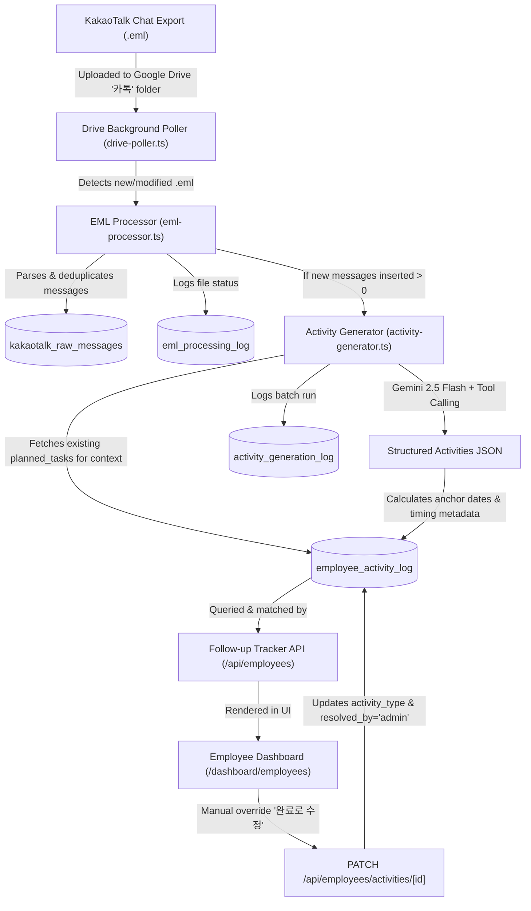

# KakaoTalk Task & To-Do List System (Handoff Guide)

This document explains how the Youngil ONC dashboard ingests KakaoTalk work-report conversations, extracts structured **To-Do items (`planned_task`)** and **Completed Tasks (`completed_task`)**, and reconciles them in the **Follow-up Tracker** and **Employee Activity Calendar**.

---

## 1. End-to-End Architecture



### Core Source Files
| Component | File Path | Responsibility |
| :--- | :--- | :--- |
| **Drive Poller** | [`src/lib/drive-poller.ts`](file:///c:/Users/young/dev/youngillonc-dashboard/src/lib/drive-poller.ts) | Auto-starts with the server (`src/instrumentation.ts`), polls Google Drive every 30s (`DRIVE_TARGET_FOLDER_IDS`). |
| **Webhook / Change Processor** | [`src/lib/drive-webhook-processor.ts`](file:///c:/Users/young/dev/youngillonc-dashboard/src/lib/drive-webhook-processor.ts) | Downloads `.eml` files, triggers `processEMLFile` and `generateActivitiesForDateRange`, and cleans up local files. |
| **EML Parser & Deduplicator** | [`src/lib/eml-processor.ts`](file:///c:/Users/young/dev/youngillonc-dashboard/src/lib/eml-processor.ts) | Parses Korean timestamps (`YYYY년 M월 D일 오전/오후 H:MM`), extracts chat room from `Subject:`, and inserts only messages newer than `MAX(chat_date)` for that room. |
| **AI Activity Extractor** | [`src/lib/activity-generator.ts`](file:///c:/Users/young/dev/youngillonc-dashboard/src/lib/activity-generator.ts) | Groups raw messages by date, calls `gemini-2.5-flash` to classify activities (`planned_task`, `completed_task`, `issue`, `meeting`, `other`), and writes to `employee_activity_log`. |
| **Date & Timing Context** | [`src/lib/date-context.ts`](file:///c:/Users/young/dev/youngillonc-dashboard/src/lib/date-context.ts) | Parses approximate Korean date expressions (`9월초`, `중순`, `월말`, `9월말~10월초`), assigns anchor dates, and encodes timing metadata. |
| **Follow-up Matching API** | [`src/app/api/employees/route.ts`](file:///c:/Users/young/dev/youngillonc-dashboard/src/app/api/employees/route.ts) | Pairs `planned_task` records against `completed_task` records, computes `completed` / `missed` / `future` statuses, and calculates employee follow-up rates. |
| **Manual Completion API** | [`src/app/api/employees/activities/[id]/route.ts`](file:///c:/Users/young/dev/youngillonc-dashboard/src/app/api/employees/activities/%5Bid%5D/route.ts) | Handles `PATCH` requests when a manager manually marks a planned/missed task as completed in the UI. |
| **Employee Dashboard UI** | [`src/app/dashboard/employees/page.tsx`](file:///c:/Users/young/dev/youngillonc-dashboard/src/app/dashboard/employees/page.tsx) | Displays the Follow-up Tracker, Activity Calendar, Issues list, source message modal, and manual completion buttons. |

---

## 2. Ingestion & Message Deduplication

1. **Monitored Folder**:
   - Configured via `DRIVE_TARGET_FOLDER_IDS` in `.env.local` and stored in `drive_sync_state` (currently monitoring the **`카톡`** folder: `1k2lTGKxHdyR163adW6G7h4I7uK5fsHQY`).
   - *Important*: `.eml` exports must be uploaded to this monitored folder (not the root `EGDesk` folder) to be picked up automatically.
2. **Chat Room Identification**:
   - Extracted from the `Subject:` line of the `.eml` file (e.g., `Youngil OnC 최강 B2B 14 님과 카카오톡 대화`, `영일오엔씨 부울경 사업소^^* 화이팅~~!! 14 님과 카카오톡 대화`).
   - *Caution*: Because deduplication filters by `WHERE chat_room = '...'`, if the participant count in the KakaoTalk export subject line changes (e.g., `14` → `15`), the system treats it as a new chat room unless the `Subject:` line or room name is normalized.
3. **Incremental Message Insertion (`insertMessagesWithDuplicateCheck`)**:
   - Queries `SELECT MAX(chat_date) FROM kakaotalk_raw_messages WHERE chat_room = '...'`.
   - Only messages with `chat_date > latestDBDate` are inserted into `kakaotalk_raw_messages`.
   - If `inserted > 0`, `triggerActivityGeneration()` automatically runs for the date range of the newly inserted messages (`id > MAX(source_message_id)` for that room).

---

## 3. To-Do List Creation (`planned_task`)

When `generateActivitiesForDateRange()` runs on a day's messages (`date`), `extractActivitiesFromDay()` prompts `gemini-2.5-flash` to identify future plans and to-do items.

### Detection Rules
- **Trigger Phrases**: Messages mentioning future intent such as `"내일"`, `"예정"`, `"방문 예정"`, `"9월초"`, `"9월 중순"`, `"9월말"`, `"대보수기간"`, etc.
- **Single-Employee Rule**: `employee_name` must always be a single person. If two employees plan a joint visit (`"동행 방문"`), the AI emits two separate `planned_task` objects—one for each employee.
- **Exclusions**: `"퇴근"` (leaving work) messages and `SYSTEM` messages are ignored.

### Anchor Date Calculation (`activity_date`)
A `planned_task` created in a message on `2026-09-10` is stored in `employee_activity_log` with `activity_date` set to the **target date when the task is supposed to happen** (not the message date):
- The original message timestamp is preserved via `source_message_id` → `kakaotalk_raw_messages.chat_date` (exposed as `message_date` in the API).
- [`calculateAnchorDate()`](file:///c:/Users/young/dev/youngillonc-dashboard/src/lib/date-context.ts#L117-L174) resolves the target `activity_date` (`YYYY-MM-DD`) based on the timing context:

| `date_context` | Korean Phrasing Examples | Anchor Date Rule (`activity_date`) |
| :--- | :--- | :--- |
| **`exact`** | `"내일"`, `"9월 21일"` | Explicit date (`YYYY-MM-DD`), or `message_date + 1 day` if unspecified |
| **`early`** | `"9월초"`, `"다음달 초"`, `"월초"` | **5th** of the target month (`YYYY-MM-05`) |
| **`mid`** | `"9월 중순"`, `"중순"`, `"9월 중"` | **15th** of the target month (`YYYY-MM-15`) |
| **`late`** | `"9월말"`, `"월말"`, `"9월 하순"` | **25th** of the target month (`YYYY-MM-25`) |
| **`range`** | `"9월말~10월초"`, `"9/2~9/3"` | Start date of the range (or `YYYY-MM-25` fallback) |
| **`unspecified`** | `"상반기"`, `"하반기"`, `"10월경"` | **15th** of the target month (`YYYY-MM-15`) |

### Encoding Timing Metadata in `action_taken`
Because `employee_activity_log` has a fixed column schema, non-exact timing context for planned tasks is persisted inside the `action_taken` column using [`encodeTimingContext()`](file:///c:/Users/young/dev/youngillonc-dashboard/src/lib/date-context.ts#L18-L20):
```text
timing:<date_context>|<date_context_raw>
# Example: "timing:mid|9월 중순"
```
When reading rows back, [`extractDateContext()`](file:///c:/Users/young/dev/youngillonc-dashboard/src/lib/date-context.ts#L25-L112) decodes `action_taken` (or falls back to regex scanning the message text) to display badges like `9월 중순` or `초` in the UI and apply flexible matching windows.

---

## 4. "Task Done" Handling (`completed_task`)

There are **three ways** a task is recorded and matched as Done (`completed`):

### A. Context-Aware AI Extraction (`activity-generator.ts`)
1. **Pre-Prompt Plan Injection**:
   - Before analyzing messages for date `D`, [`fetchPlannedTasksForDate(D)`](file:///c:/Users/young/dev/youngillonc-dashboard/src/lib/activity-generator.ts#L133-L153) queries `employee_activity_log` for all `planned_task` rows where `activity_date = D`.
   - These planned tasks (`employee_name`, `activity_label`, `customer`, `location`, `products`) are injected directly into the Gemini prompt under `"Planned tasks for today (to help match completed work with plans)"`.
   - This ensures that when an employee reports work done on day `D`, Gemini uses consistent `customer` and `activity_label` naming so the downstream matcher can link the completion to the plan.
2. **Historical Context Tool (`search_previous_activities`)**:
   - Gemini is provided with the `search_previous_activities` function declaration. If a message references ongoing work or a previous issue without repeating the customer name, Gemini can look back 1–7 days in `employee_activity_log` to resolve the context.
3. **Output**:
   - Extracted with `activity_type = 'completed_task'`, `activity_date = D` (the message date), and `confidence_score = 0.85`.

---

### B. Automated Follow-Up Matching (`/api/employees`)
When the Follow-up Tracker loads for a `startDate` ~ `endDate` window, [`GET /api/employees`](file:///c:/Users/young/dev/youngillonc-dashboard/src/app/api/employees/route.ts#L35-L306) reconciles To-Do items against Completed Tasks:

1. **Candidate Pools**:
   - **Planned Pool (`plannedTasks`)**: `activity_type IN ('planned_task', 'planning')` with `confidence_score >= 0.7`.
   - **Actual Pool (`actualActivities`)**: `activity_type IN ('completed_task', 'work_completed', 'sales_activity')` with `confidence_score >= 0.7`.
2. **Status Classification (`future` vs `completed` vs `missed`)**:
   - **Future (`future`)**: If `planned.next_action_date > today` (local date), the task is not yet due and is marked `future`.
   - **Completed (`completed`)**: If `planned.next_action_date <= today` and a matching `actual` activity is found (each `actual.id` can only be consumed once via `usedActualIds`).
   - **Missed (`missed`)**: If `planned.next_action_date <= today` and no matching `actual` activity is found.
3. **Date Window Matching Rules**:
   - Must belong to the **same `employee_name`**.
   - If `date_context === 'exact'`: requires exact date match (`actual.activity_date === planned.next_action_date`).
   - If `date_context !== 'exact'`: requires the **same `YYYY-MM` month** plus day-of-month window:
     - `early`: day `1` – `12` (`actualDay <= 12`)
     - `mid`: day `7` – `23` (`7 <= actualDay <= 23`)
     - `late`: day `18` – `31` (`actualDay >= 18`)
     - `range` / `unspecified`: any day within the same `YYYY-MM` month.
4. **Content Relevance & Scoring Rules**:
   - Candidate matches within the date window are scored and sorted:
     - `+200` if `actual.id === planned.id` (e.g., in-place manual completion)
     - `+100` if `actual.customer_name` includes `planned.customer_name`
     - `+60` if `actual.activity_summary` (raw message) includes `planned.customer_name`
     - `+80` if `actual.activity_label === planned.activity_label`
     - `+40` if `actual.activity_summary` includes `planned.activity_label`
   - **Minimum Match Threshold**:
     - If the plan has a `customer_name`, the actual activity **must** match that customer in either `customer_name` or `activity_summary`.
     - If the plan has no `customer_name`, it **must** match `activity_label` in either `activity_label` or `activity_summary`.
     - If neither `customer_name` nor `activity_label` is present on the plan, auto-matching is disabled (`false`) to prevent false positives.

---

### C. Manual Admin Override ("완료로 표시" / "완료로 수정")
If an employee completed a planned task offline or reported it verbally to a manager without a matching KakaoTalk message:

1. **UI Trigger**:
   - In [`/dashboard/employees`](file:///c:/Users/young/dev/youngillonc-dashboard/src/app/dashboard/employees/page.tsx), clicking **"완료로 표시"** (on an Activity Calendar card) or **"완료로 수정"** (on a `missed` card in the Follow-up Tracker) calls `markActivityAsCompleted(activityId)`.
2. **API Mutation (`PATCH /api/employees/activities/[id]`)**:
   - Updates the row in `employee_activity_log` in-place:
     - `activity_type = 'completed_task'`
     - `confidence_score = 1`
     - `resolved_by = 'admin'`
     - `action_taken = 'manual_completion'`
     - `outcome = '관리자 보고로 완료 처리'` (or custom `completion_reason`)
3. **Effect on Metrics**:
   - Converting `activity_type` from `planned_task` to `completed_task` removes the item from the unfulfilled `planned_task` pool and displays it as a completed green card (`✓`) on the Activity Calendar with the admin completion note (`outcome`).

---

## 5. Follow-Up Rate & Cycle Metrics

1. **Follow-up Rate (`followUpRate`)**:
   $$\text{Actionable Tasks} = \text{Total Planned} - \text{Future}$$
   $$\text{Follow-up Rate (\%)} = \left( \frac{\text{Completed}}{\text{Actionable Tasks}} \right) \times 100$$
   *(Future tasks are excluded from the denominator so employees are not penalized for upcoming plans.)*
2. **Follow-up Cycle (`팔로업 주기`)**:
   - Calculated in UI as `ceil(|next_action_date - message_date| in days)`.
   - Default thresholds in UI (adjustable per session):
     - **우수 (Good)**: $\le 1\text{ day}$
     - **보통 (Normal)**: $\le 7\text{ days}$
     - **경고 (Warning)**: $> 7\text{ days}$

---

## 6. Database Tables Reference

| Table | Purpose | Key Columns |
| :--- | :--- | :--- |
| `kakaotalk_raw_messages` | Raw parsed KakaoTalk messages | `id`, `chat_room`, `chat_date` (ISO), `user_name`, `message` |
| `employee_activity_log` | Extracted To-Dos, Completed Tasks, Issues, Meetings | `id`, `source_message_id`, `employee_name`, `activity_date` (`YYYY-MM-DD`), `activity_type`, `activity_label`, `customer`, `location`, `products` (JSON array), `outcome`, `issue_severity`, `action_taken`, `resolved_by`, `chat_room`, `confidence_score` |
| `eml_processing_log` | Audit log of processed `.eml` files | `file_id`, `file_name`, `chat_room`, `status`, `messages_found`, `messages_inserted`, `messages_duplicate` |
| `activity_generation_log` | Audit log of Gemini extraction runs | `eml_file_id`, `chat_room`, `status`, `activities_generated`, `start_date`, `end_date` |
| `drive_sync_state` | Google Drive change token & watched folders | `id=1`, `page_token`, `target_folder_ids` |
| `drive_file_events` | Log of Drive file create/modify/delete events | `file_id`, `file_name`, `mime_type`, `folder_id`, `event_type`, `downloaded` |
